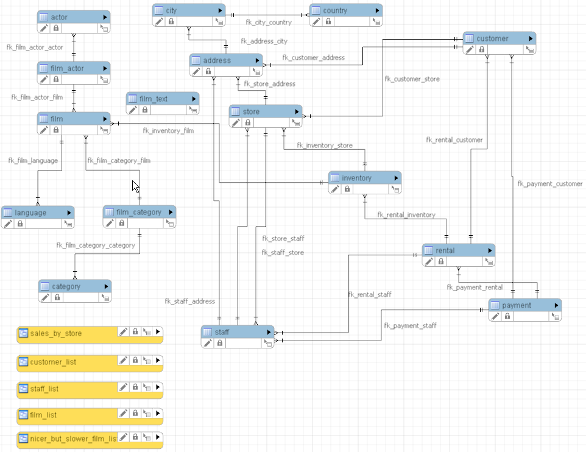
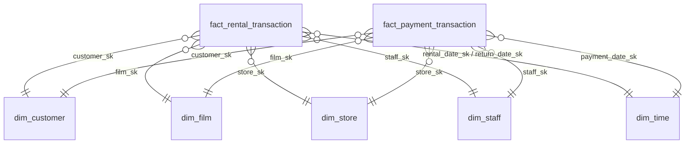

# duckdb-sakila-warehouse

A star-schema data warehouse built from the [Sakila](https://dev.mysql.com/doc/sakila/en/) DVD-rental database, using **dbt** and **DuckDB**.

Sakila is a normalized OLTP schema (customers, rentals, payments, inventory, films). This project reshapes it into an analytical model and answers business questions with plain SQL on top of it.



## What's in it

| Layer | Models | Materialization |
|---|---|---|
| Staging | 13 `stg_*` models, one per source table, cleaned and renamed | view |
| Dimensions | `dim_customer`, `dim_film`, `dim_store`, `dim_staff`, `dim_time` | table |
| Facts | `fact_rental_transaction`, `fact_payment_transaction` | table |
| Analyses | 6 queries in `analyses/` | compiled on demand |



Models are organised by business area in `models/staging/` and by role (`dimensions/`, `facts/`) in `models/marts/`.

## Design decisions

- **Grain.** `fact_rental_transaction` has one row per rental (16,044). A rental is one inventory copy of one film, so `film_sk` sits directly on the fact and no bridge is needed. `fact_payment_transaction` has one row per payment (16,049).
- **Surrogate keys.** Dimensions use an md5 hash of the natural key (`dbt_utils.generate_surrogate_key`). Facts take the key by joining to the dimension on the natural key, so every dimension builds before the facts.
- **Degenerate keys.** `rental_id` and `payment_id` stay in the facts. They identify the event and have no attributes of their own.
- **Role-playing date dimension.** `dim_time` is joined as `rental_date_sk`, `return_date_sk` and `payment_date_sk`. Its range is fixed (2005-01-01 to 2006-12-31) so the table is identical on every build.
- **Flattened location.** Address, city and country are denormalized into `dim_customer` and `dim_store` instead of a separate location dimension. City → country is a fixed-depth many-to-one hierarchy, which Kimball recommends flattening. A conformed `dim_location` would only be needed to slice customers and stores by one shared geography.
- **Default rows instead of null keys.** Missing keys point to a `-1` row ("No date" in `dim_time`, "Unknown" in `dim_film` and `dim_store`), so inner joins never drop fact rows.
- **Data minimisation.** Personal data never reaches the marts. Customer and staff names and emails and all postal codes are dropped in staging, and customer street addresses are not carried into `dim_customer`. Store addresses are kept because they are business data used to identify stores. Models keep only what the analytical questions need.
- **One category per film.** Every film has exactly one category, so category is flattened into `dim_film`.
- **Type 1 dimensions.** Dimensions are rebuilt from the current source on every `dbt build`, so a changed attribute overwrites the old value and no history is kept. Sakila has no change history to build from anyway. Tracking changes would need dbt snapshots (SCD2).

## Data quality

`dbt build` runs the models and their tests together: `unique` and `not_null` on keys (including every fact foreign key), and `relationships` tests from every fact key to its dimension and from staging to staging. Facts to dimensions are checked through the surrogate keys.

## Analyses

Business questions answered against the facts and dimensions, in `analyses/`:

| File | Question |
|---|---|
| `revenue_by_store` | How much revenue does each store bring in? |
| `monthly_revenue` | How does revenue develop month by month? |
| `top_films_by_revenue` | Which films earn the most? |
| `revenue_by_category` | Which categories drive revenue, and what share? |
| `late_returns_by_store` | What share of returned rentals are kept longer than allowed? |
| `customer_value_segments` | How concentrated is revenue across customer quartiles? |

## Run it

Requires [uv](https://docs.astral.sh/uv/) and Python 3.12+. The Sakila database is included at `data/sakila.duckdb`.

```bash
uv sync
uv run dbt deps
uv run dbt build                          # models + tests
uv run dbt show --select revenue_by_store # run an analysis
uv run dbt docs generate && uv run dbt docs serve   # lineage graph
```

## Limitations and possible extensions

- Actors are not modelled. A film ↔ actor bridge table with an allocation weight would enable revenue per actor.
- A shared `dim_location` (city grain) with role-playing keys on the facts.
- SCD2 history through dbt snapshots.
- Incremental fact models for scale (marts are full tables here).
- The date dimension uses DuckDB functions and is not portable to other engines as written.

## Stack

dbt-core, dbt-duckdb, dbt_utils, DuckDB, uv.
